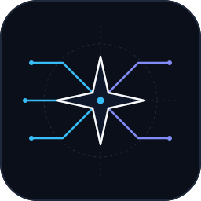
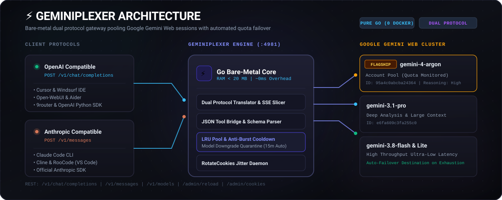

<div align="center">



# Geminiplexer

**Native Go gateway multiplexing Google Gemini Web sessions into standard OpenAI and Anthropic Claude APIs.**

[](https://golang.org)
[](https://github.com/Bgzzxxy/geminiplexer/releases)
[](https://github.com/Bgzzxxy/geminiplexer/releases)
[](https://github.com/Bgzzxxy/geminiplexer)
[](LICENSE)

</div>

<p align="center">
  
</p>

## Overview

Geminiplexer is a lightweight, zero-dependency reverse proxy written in Go that translates standard OpenAI (`/v1/chat/completions`) and Anthropic Claude (`/v1/messages`) requests into Google Gemini Web RPC calls.

It enables direct access to flagship reasoning models like **Gemini 4 Argon** and **Gemini 3.1 Pro** from developer tools (Claude Code CLI, Cursor, Windsurf, Cline, Open-WebUI, 9router) without Docker or third-party cloud intermediaries.

### Core Capabilities

- **Dual-Protocol Endpoints**: Exposes both OpenAI Chat Completions and Anthropic Messages protocols with streaming Server-Sent Events (SSE) and tool calling.
- **Multi-Account Quota Pooling**: Pools multiple Google accounts using Least-Recently-Used (LRU) rotation with a configurable anti-burst delay (minimum 2 seconds between requests per account).
- **Silent Downgrade Circuit Breaker**: Google Web silently degrades Pro/Argon requests to Flash when session quotas are exhausted. Geminiplexer inspects upstream response headers, detects the downgrade on the initial frame, quarantines the depleted account for 15 minutes, and transparently retries on an alternate account.
- **Automated Cookie Maintenance**: Refreshes session tokens via Google's `RotateCookies` RPC endpoint with randomized jitter to sustain long-running daemon execution.
- **Incremental SSE Delta Slicing**: Converts Google Web's cumulative text snapshots into clean incremental deltas, preventing duplicated token emissions.
- **Zero Runtime Dependencies**: Compiles to a static Linux, macOS, or Windows executable with a memory footprint under 20 MB.

---

## Comparison

| Metric / Capability | Geminiplexer | Python/Node Web Proxies | Cloud Paid APIs |
|:---|:---|:---|:---|
| **Runtime Architecture** | Native Go Static Binary | Docker / Node.js / Python | Hosted SaaS |
| **Memory Footprint** | < 20 MB | 400 MB - 1 GB | External |
| **Docker Required** | No | Typically Yes | No |
| **Gemini 4 Argon** | Supported (`95a4c0abcba24364`) | Inconsistent / Flash Only | Enterprise Gated |
| **Client Protocols** | OpenAI + Anthropic Claude | OpenAI Only | Vendor Specific |
| **Multi-Account Pooling** | Built-in LRU + Anti-Burst | Single Account | Billing Account |
| **Downgrade Protection** | 15-Minute Automatic Quarantine | Silent Fallback | 429 Status |
| **Session Lifetime** | Background Jitter Rotation | Manual Re-authentication | API Key |
| **Tool / Function Calling** | Universal Two-Way Bridge | Limited / None | Native |

---

## Supported Models

Models are dynamically queried via batchexecute RPC `otAQ7b` and mapped to internal Google cluster endpoints:

| Model Identifier | Internal Google ID | Tier | Purpose |
|:---|:---|:---|:---|
| `gemini-4-argon` | `95a4c0abcba24364` | Flagship | Complex engineering, architecture, deep reasoning |
| `gemini-3.1-pro` | `e6fa609c3fa255c0` | Pro | Extended context reasoning and analysis |
| `gemini-3.8-flash` | `56fdd199312815e2` | Fast | High-throughput general completions |
| `gemini-flash-lite` | `8c46e95b1a07cecc` | Minimal | Ultra-low latency categorization |
| `gemini-auto` | `auto` | Dynamic | Google Web default automatic routing |

---

## Installation

Download pre-compiled binaries from [GitHub Releases](https://github.com/Bgzzxxy/geminiplexer/releases) or compile from source.

### Building from Source

Requires Go 1.23 or later.

```bash
git clone https://github.com/Bgzzxxy/geminiplexer.git
cd geminiplexer
./scripts/build.sh
```

Pre-compiled archives available on the Releases page:
- Linux: `geminiplexer-linux-amd64.tar.gz`, `geminiplexer-linux-arm64.tar.gz`
- macOS: `geminiplexer-darwin-arm64.tar.gz` (Apple Silicon), `geminiplexer-darwin-amd64.tar.gz` (Intel)
- Windows: `geminiplexer-windows-amd64.zip`, `geminiplexer-windows-arm64.zip`

---

## Configuration

Configuration is managed via `accounts.yaml`.

```yaml
host: "127.0.0.1"
port: 4981
admin_key: "change_to_a_secure_token"

accounts:
  - id: "primary"
    auth_user: "" # Leave empty for the root account session (/app)
    cookies: "__Secure-1PSID=...; __Secure-1PSIDTS=..."
    refresh_interval_min: 1440

  - id: "secondary"
    auth_user: "1" # Set to the slot number if signed into multiple accounts (/u/1/app)
    cookies: "__Secure-1PSID=...; __Secure-1PSIDTS=..."
    refresh_interval_min: 1440
```

### Cookie Extraction Procedure

1. Sign in to [gemini.google.com](https://gemini.google.com) in your browser.
2. Open Developer Tools (`F12` or `Ctrl+Shift+I`) and navigate to the **Network** tab.
3. Reload the page and select any request to `gemini.google.com` (such as `batchexecute`).
4. Copy the entire value of the **`Cookie`** request header (must include `__Secure-1PSID` and `__Secure-1PSIDTS`).
5. If the URL contains an account slot path (e.g. `gemini.google.com/u/2/app`), set `auth_user: "2"`. For default accounts (`/app`), leave `auth_user: ""`.

---

## Service Management

### Linux (`systemd`)

Install as a systemd user service:

```bash
mkdir -p ~/.config/systemd/user
cp systemd/gemini-to-api.service ~/.config/systemd/user/geminiplexer.service
systemctl --user daemon-reload
systemctl --user enable --now geminiplexer.service
```

### macOS (`launchd`)

Install as a launchd agent:

```bash
cp launchd/com.geminiplexer.plist ~/Library/LaunchAgents/
launchctl load ~/Library/LaunchAgents/com.geminiplexer.plist
```

### Windows

Run `scripts/start.bat` or execute directly in PowerShell:

```powershell
.\geminiplexer.exe -config accounts.yaml
```

---

## Tool and Client Integration

### Claude Code CLI

Direct the Claude Code terminal tool to Geminiplexer:

```bash
export ANTHROPIC_BASE_URL="http://127.0.0.1:4981"
export ANTHROPIC_API_KEY="not-needed"

claude "Explain the concurrency model in internal/pool/pool.go"
```

### 9router

Geminiplexer integrates directly as an upstream provider in [9router](https://github.com/decolua/9router):

- **Provider Base URL**: `http://127.0.0.1:4981/v1`
- **Protocol**: OpenAI or Anthropic Claude
- **Registered Models**: `gemini-4-argon`, `gemini-3.1-pro`, `gemini-3.8-flash`

### Cursor & Windsurf

In Cursor or Windsurf settings:
- **OpenAI Base URL**: `http://127.0.0.1:4981/v1`
- **API Key**: Any string (e.g. `sk-geminiplexer`)
- **Override Models**: `gemini-4-argon`, `gemini-3.1-pro`

---

## API Examples

### Anthropic Claude Protocol (`POST /v1/messages`)

```bash
curl -X POST http://127.0.0.1:4981/v1/messages \
  -H "Content-Type: application/json" \
  -d '{
    "model": "gemini-4-argon",
    "max_tokens": 1024,
    "messages": [
      {"role": "user", "content": "Explain raft leader election in three bullet points."}
    ]
  }'
```

### OpenAI Chat Protocol with Streaming (`POST /v1/chat/completions`)

```bash
curl -N -X POST http://127.0.0.1:4981/v1/chat/completions \
  -H "Content-Type: application/json" \
  -d '{
    "model": "gemini-4-argon",
    "stream": true,
    "messages": [
      {"role": "user", "content": "Write a thread-safe LRU cache in Go."}
    ]
  }'
```

### Tool Calling (`POST /v1/messages`)

```bash
curl -X POST http://127.0.0.1:4981/v1/messages \
  -H "Content-Type: application/json" \
  -d '{
    "model": "gemini-4-argon",
    "messages": [
      {"role": "user", "content": "What is the stock price of NVDA?"}
    ],
    "tools": [{
      "name": "get_stock_quote",
      "description": "Fetch current stock price for a ticker",
      "input_schema": {
        "type": "object",
        "properties": {
          "ticker": {"type": "string"}
        },
        "required": ["ticker"]
      }
    }]
  }'
```

---

## Administration Endpoints

Geminiplexer exposes administration routes protected by Bearer token (`admin_key` in `accounts.yaml`):

- `POST /admin/reload`: Reloads `accounts.yaml` from disk without interrupting active connections.
- `POST /admin/cookies`: Updates session cookies dynamically via JSON body (`{"id": "...", "cookies": "..."}`).

---

## Architecture Reference

Detailed specifications on the Google Gemini Web wire protocol, including length-prefixed stream framing, batchexecute array structures, and internal RPC signatures, are documented in [KNOWLEDGE_BASE.md](KNOWLEDGE_BASE.md).

---

## Disclaimer

This project is intended strictly for educational, research, and local development purposes. It connects to Google Gemini Web through reverse-engineered web interfaces and is not affiliated with or endorsed by Google LLC. Please use responsibly and respect upstream service terms.

---

## License

Distributed under the [MIT License](LICENSE).
